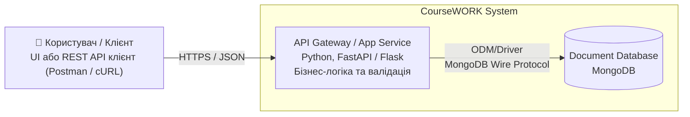

# System Design Document (SDD): Курсовий проєкт (Python + MongoDB)

## 1. Вступ та архітектурний огляд

Цей документ описує внутрішню структуру, компоненти, модель даних та інтерфейси взаємодії нашого вебзастосунку, розробленого на базі **Python** та **MongoDB**. Система призначена для обробки, збереження та аналізу даних користувачів із використанням сучасних патернів проєктування.

## 2. C4-діаграма контейнерів (Mermaid)

Архітектура системи побудована за принципом мікросервісного/модульного моноліта і складається з таких контейнерів:



## 3. Опис компонентів та їхні залежності

### 3.1. API Service (`app/`)

- **Відповідальність:** прийом запитів, маршрутизація, обробка бізнес-правил та генерація відповідей.
- **Ключові залежності:** підключення до БД, модулі валідації (див. [ADR-0001](adr/0001-use-fastapi-or-flask-for-python.md)).
- **Зв'язок з інфраструктурою:** розгортається у вигляді контейнера згідно з [ISD](isd.md).

### 3.2. Database Driver / ODM (`pymongo` / `motor`)

- **Відповідальність:** абстракція над MongoDB, виконання запитів, керування сесіями.
- **Ключові залежності:** MongoDB Instance (див. [ADR-0002](adr/0002-choose-mongodb-as-document-store.md)).

## 4. Модель даних (Схема колекцій MongoDB)

Оскільки використовується нереляційна БД MongoDB, дані організовані у вигляді документо-орієнтованих колекцій.

### 4.1. Колекція `users`

Зберігає профільні дані та налаштування.

```json
{
  "_id": "ObjectId",
  "username": "string",
  "email": "string",
  "created_at": "ISODate"
}
```

### 4.2. Колекція `records`

Профільна бізнес-сутність.

```json
{
  "_id": "ObjectId",
  "user_id": "ObjectId",
  "payload": "object",
  "status": "string"
}
```

## 5. Перелік API-контрактів

| Метод | Ендпоінт | Опис |
|-------|----------|------|
| `GET` | `/api/v1/health` | Перевірка стану сервісу (Health Check) |
| `GET` | `/api/v1/items` | Отримання списку сутностей |
| `POST` | `/api/v1/items` | Створення нового документа в MongoDB |
| `POST` | `/api/v1/analytics/generate` | Генерація аналітичного звіту |